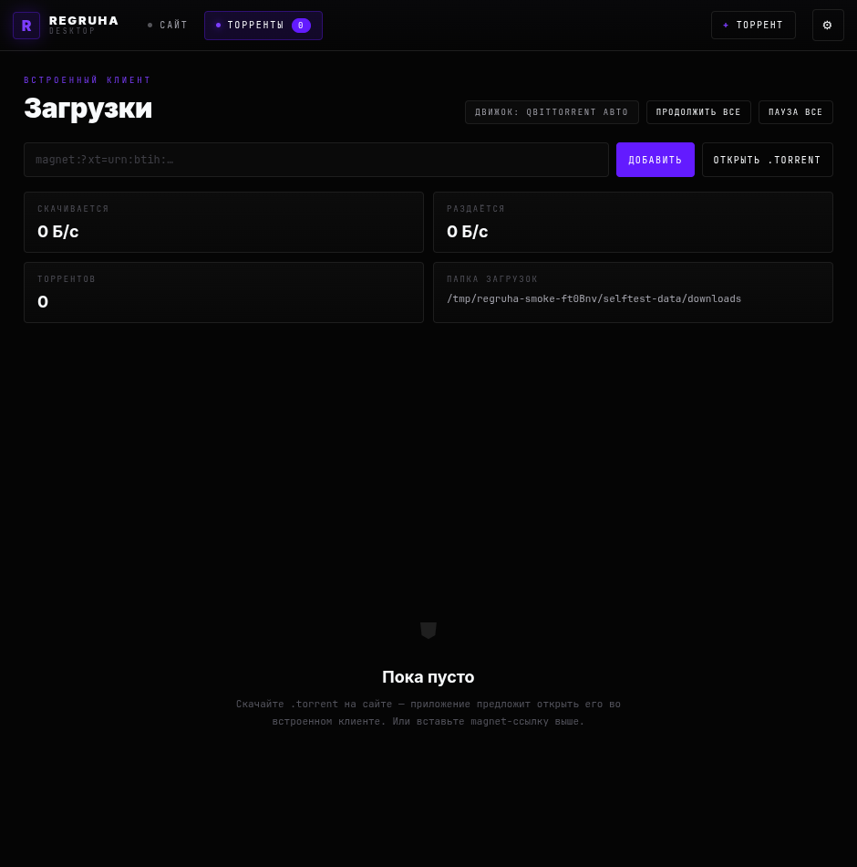
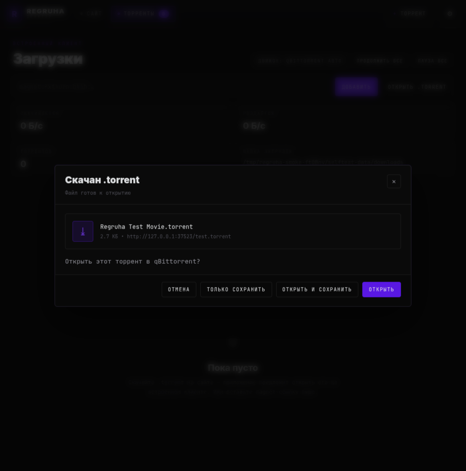
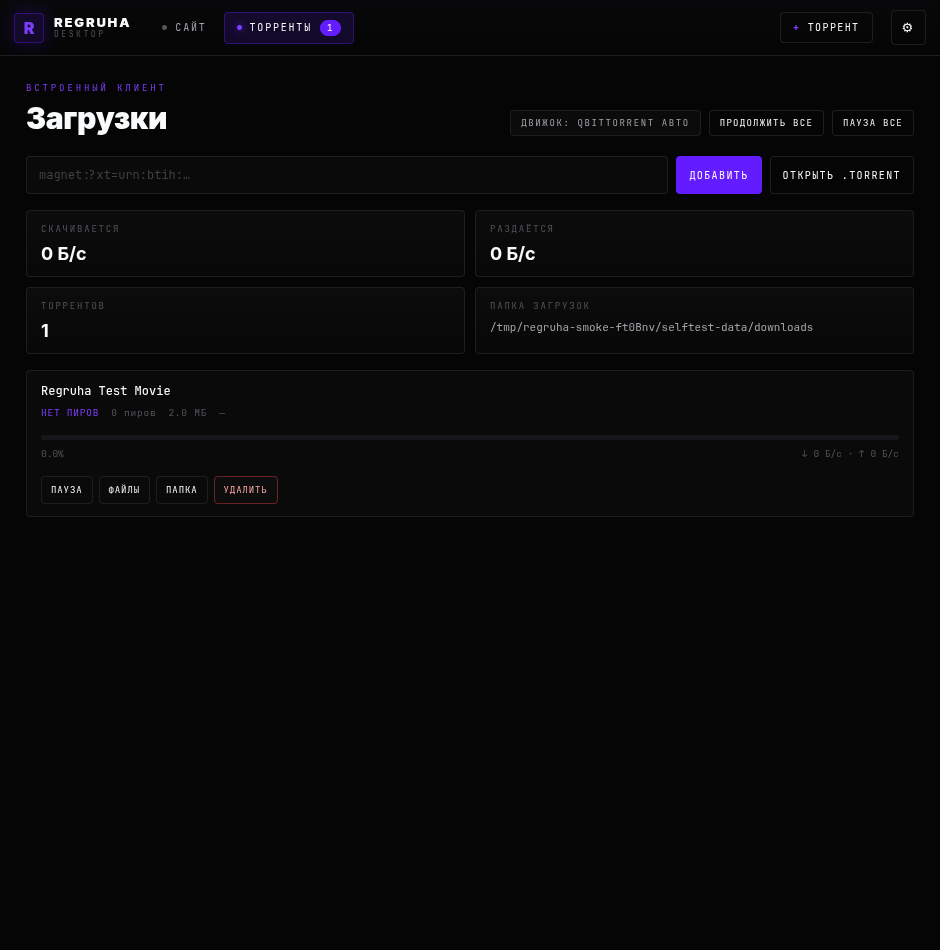
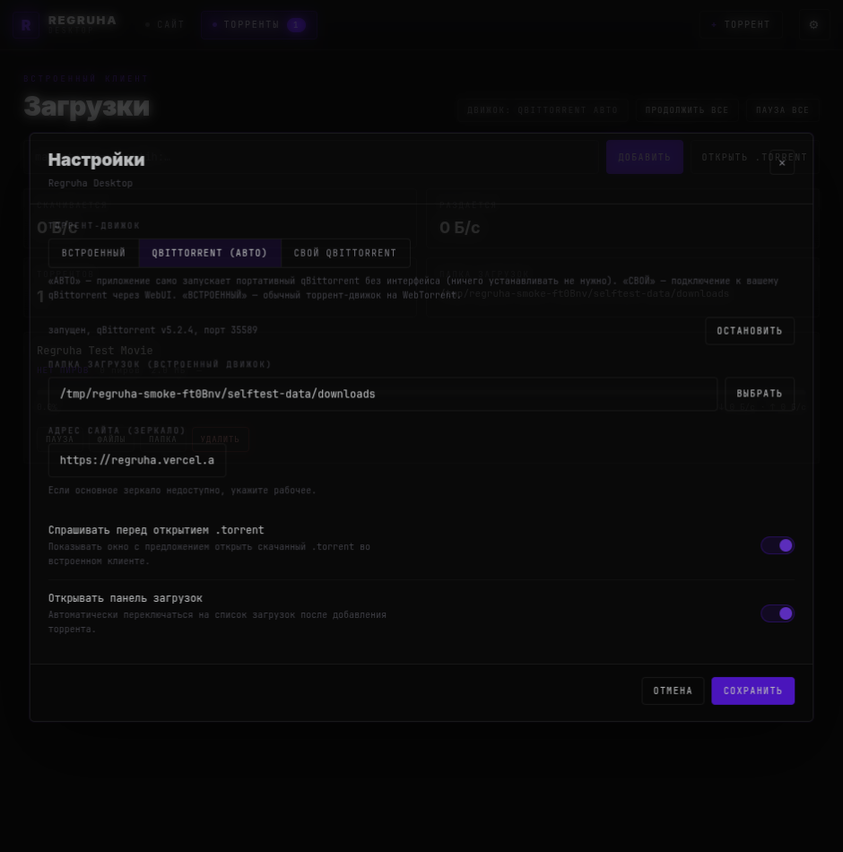

# Regruha Desktop

Десктоп-клиент **Regruha** со встроенным торрент-клиентом. Приложение оборачивает
сайт в отдельное окно Electron, повторяет его оформление (тёмная тема, акцент
`#631bff`, шрифты Schibsted Grotesk и JetBrains Mono) и добавляет полноценную
панель загрузок.

> Это клиент-обёртка: приложение не хранит и не распространяет контент, а лишь
> открывает сайт и умеет скачивать торренты, которые вы ему передаёте.

## Возможности

- **Сайт в отдельном окне** — постоянная сессия (`persist:regruha`), кнопки «обновить»,
  «открыть в системном браузере», экран «нет связи» с быстрым переходом в настройки.
- **Устойчивость к плохой сети** — если сайт не ответил, приложение само перезагружает
  его с нарастающими паузами и сразу восстанавливает при появлении интернета. На экране
  «нет связи» видна причина (код ошибки), а браузерный User-Agent очищен от упоминаний
  Electron, чтобы сайты не блокировали встроенное окно.
- **Панель загрузок** — полноценный торрент-клиент внутри приложения.
- **qBittorrent «под капотом»** — приложение само запускает портативный qBittorrent
  и управляет им по WebUI. Ничего устанавливать в систему не нужно, всё хранится в
  профиле приложения. На Linux это headless `qbittorrent-nox`, на Windows — обычный
  qBittorrent со спрятанным окном (см. «Движки»).
- **Установка при первом торренте** — если встроенный qBittorrent ещё не скачан, при
  первом добавлении торрента появляется окно «Установка qBittorrent» с прогрессом.
- **Плавающая мини-панель** — вместо верхней панели: переключение между сайтом и
  загрузками, счётчик торрентов и настройки внутри вкладки загрузок.
- **Подключение к вашему qBittorrent** через WebUI — если он уже установлен, приложение
  просто управляет им; отдельный движок не запускается.
- **Портативный режим** — положите рядом с приложением файл `portable`, и все данные
  (настройки, торренты, профиль qBittorrent) будут храниться в его папке.
- **Перехват `.torrent`** — при скачивании торрент-файла приложение предлагает:
  *Открыть*, *Открыть и сохранить*, *Только сохранить* или *Отмена*.
- **Magnet-ссылки** — `magnet:` открывается в приложении (одиночный экземпляр,
  регистрация как обработчика по умолчанию).
- **Выбор файлов** внутри торрента, пауза/возобновление, удаление вместе с данными,
  открытие папки с загрузкой, сохранение сессии между запусками.
- **Детали загрузки**: прогресс, скорость отдачи/загрузки, пиры, оставшееся время.

## Скриншоты

| Список загрузок | Предложение открыть `.torrent` |
| --- | --- |
|  |  |

| Загрузка в процессе | Настройки |
| --- | --- |
|  |  |

## Требования

- **Node.js 20+** и npm.
- Linux, Windows или macOS.
- Для режима **Свой qBittorrent** — установленный и запущенный qBittorrent с включённым
  WebUI (необязательно; режим «авто» работает без него).
- Режим **qBittorrent «авто»** работает на **Linux** (x64/arm64/armv7/ia32) и
  **Windows x64** — в сборку для Windows вложен готовый qBittorrent. На macOS
  готовых headless-сборок нет, используйте свой qBittorrent.

## Быстрый старт

```bash
npm install
npm run fetch:qb   # портативный qBittorrent для режима «авто» (необязательно)
npm start          # обычный запуск
npm run dev        # запуск с инструментами разработки
```

### Важно: npm 12 блокирует install-скрипты

Начиная с npm 12 postinstall-скрипты пакетов не выполняются без явного разрешения.
Для этого проекта нужно разрешить два пакета:

```bash
# скачать бинарник Electron (иначе окно не запустится)
npm install-scripts approve electron
node node_modules/electron/install.js

# нативный модуль WebRTC-транспорта (webtorrent — только для тестов/dev)
npm install-scripts approve node-datachannel
cd node_modules/node-datachannel && npx --no-install prebuild-install -r napi && cd ../..
```

В `package.json` уже есть поле `allowScripts` для `node-datachannel`, но Electron
при первой установке всё равно требует `node node_modules/electron/install.js`.

`webtorrent` теперь нужен только тестам (раздача пробного торрента) и в само
приложение не входит. Пакеты `bufferutil`, `utf-8-validate` и `utp-native` —
необязательные оптимизации WebTorrent; их заблокированные скрипты на работу не влияют.

## Движки

Переключаются в **Настройки** (вкладка «Загрузки»). Доступны два варианта.

### qBittorrent «авто» (по умолчанию)

Приложение запускает портативный qBittorrent и управляет им по WebUI API — тем же
кодом, что и для внешнего qBittorrent. Установка в систему не нужна.

**Linux.** Скачивается статический `qbittorrent-nox` (сборка
[userdocs/qbittorrent-nox-static](https://github.com/userdocs/qbittorrent-nox-static))
и стартует совсем без графического интерфейса.

**Windows.** Готовых headless-сборок для Windows не выпускают, поэтому в комплект
вложен официальный qBittorrent, а его окно спрятано: он стартует сразу в трей
(`GUI\StartUpWindowState=Hidden`) и виден только значком в области уведомлений.

- Профиль qBittorrent лежит в `<профиль>/qbittorrent/profile`, сам бинарник — в
  `<профиль>/qbittorrent/bin` (Linux) или рядом с приложением (Windows, из `vendor/`).
  Файл настроек — `qBittorrent.ini` на Windows/macOS и `qBittorrent.conf` на Linux
  (так его ищет сам qBittorrent; с неверным расширением он стартует с настройками по умолчанию).
- WebUI слушает только `127.0.0.1` на случайном свободном порту, локальная авторизация
  отключена — снаружи подключиться нельзя.
- В **Настройки** видно состояние встроенного qBittorrent и кнопку
  «СКАЧАТЬ И ЗАПУСТИТЬ». На Linux бинарник (~64 МБ) скачивается только по этой кнопке
  или при добавлении первого торрента (окно «Установка qBittorrent») — при простом
  запуске приложение ничего не тянет. На Windows скачивать нечего: движок уже в сборке.
- При закрытии приложения qBittorrent гасится автоматически (в том числе при завершении
  по сигналу), «осиротевших» процессов не остаётся.
- На **macOS** режим «авто» недоступен — используйте свой qBittorrent.

Если бинарник уже скачан или лежит в `vendor/qbittorrent/<платформа-архитектура>/`,
загрузка из сети не нужна. Путь можно задать и переменной `REGRUHA_QB_BINARY`.

### Свой qBittorrent WebUI

Приложение подключается к вашему qBittorrent и управляет им по API v2.

1. Откройте qBittorrent → **Инструменты → Настройки → WebUI**.
2. Включите **Web User Interface (Remote control)**.
3. Задайте логин и пароль (по умолчанию `admin`).
4. Проверьте порт (по умолчанию `8080`) и адрес прослушивания.
5. Если qBittorrent и приложение на разных машинах, снимите галочку
   «Bypass authentication for clients on localhost» и настройте доступ.
6. В приложении: **Настройки → Адрес WebUI** → укажите `http://127.0.0.1:8080`,
   логин и пароль → **Проверить подключение**.

Поддерживаются qBittorrent 4.x и 5.x (в 5.x приложение автоматически использует новые
эндпоинты `start`/`stop` и cookie `QBT_SID_<порт>`).

### Профиль и портативный режим

Профиль (`userData`) — это `~/.config/Regruha` (Linux), `%APPDATA%\Regruha` (Windows)
или `~/Library/Application Support/Regruha` (macOS).

Чтобы держать все данные рядом с приложением, положите файл с именем `portable`
рядом с исполняемым файлом (или задайте переменную окружения `REGRUHA_PORTABLE=1`).
Тогда профиль будет в папке `regruha-data` рядом с приложением.

## Режим разработчика

Нужен, чтобы подключаться к **dev-сборкам** сайта, которые живут по произвольному
адресу (например, `xxxxxxxx.pages.dev`, `.github.io`) или по IP.

Как включить:

1. Откройте **Настройки**.
2. Трижды щёлкните по подписи **«Regruha Desktop»** (под заголовком «Настройки»).
3. Появится поле **«Свой адрес»** — введите любой адрес.

Схему можно не указывать: для доменов подставится `https://`, для IP и `localhost` — `http://`.
Включённое состояние запоминается, повторные три клика выключают режим (адрес вернётся к
одному из зеркал). Вне режима разработчика адреса зеркал в интерфейсе не показываются.

### Пасхалка UTORRENTIE!

В режиме разработчика появляется кнопка **UTORRENTIE!**. Она переименовывает всё
приложение и сайт внутри него: имя в окне, экран загрузки и подпись настроек начинают
зваться `UTORRENTIE!` (как та самая папка из итальянского торрент-трекера с 10-й страницы
выдачи), а торрент-движок `qBittorrent` превращается в `uTorrentie` (регистр сохраняется:
`QBITTORRENT` → `UTORRENTIE`). Вдобавок все ники на сайте — авторы новостей, тем форума,
опросов и комментариев, а также шапка профиля — становятся **Pajvajl** или **Пажважл**
(случайно для каждого ника). Повторное нажатие возвращает обычные имена. Выбор
запоминается отдельно от режима разработчика. Имена торрентов, пути к файлам и адреса
зеркал не переименовываются.

## Файлы `.torrent` и ссылки `magnet:`

- Скачивание `.torrent` на сайте перехватывается: файл временно сохраняется, затем
  появляется окно с выбором действия. Поведение можно отключить в настройках
  («Спрашивать перед открытием .torrent»).
- Если торрент-файл уже лежит на диске, его можно добавить кнопкой **«ОТКРЫТЬ .TORRENT»**.
- Ссылки `magnet:` из браузера открываются во вкладке загрузок. Обработчик
  регистрируется в системе; на Linux нужен `.desktop`-файл из установочного пакета.

## Сборка

Установщики собираются [electron-builder](https://www.electron.build/).

Перед сборкой положите портативный qBittorrent для нужных систем в `vendor/` —
иначе в Linux-сборке режим «авто» будет скачивать его при первом запуске, а
Windows-сборка останется без встроенного движка:

```bash
npm run fetch:qb                          # для текущей системы
npm run fetch:qb:win                      # Windows x64 (нужен 7-Zip)
npm run fetch:qb linux-x64 linux-arm64    # или явно, можно несколько
```

Готовые файлы из `vendor/qbittorrent/` попадают в сборку как ресурсы. Linux- и
Windows-бинари упаковываются каждый в свою платформу, поэтому чужой файл в сборку
не тянется.

```bash
npm run dist:linux   # AppImage + deb
npm run dist:win     # NSIS + portable
npm run dist:mac     # dmg + zip
npm run dist:aur     # пакет Arch Linux из свежего AppImage
```

Результат — в папке `release/`, пакет Arch Linux — в `aur/`:

```bash
sudo pacman -U aur/regruha-desktop-1.0.0-1-x86_64.pkg.tar.zst
```

Кросс-сборка возможна не для всех целей: macOS-сборку (`dmg`) собирают на macOS,
Windows-инсталлятор — на Windows или в Wine (Linux-цели собираются где угодно).

Иконка лежит в `build/icon.png` (512×512), из неё electron-builder сам делает `.ico`
и `.icns`, а также набор размеров для Linux (`build/icons/`).

Сборка не использует подпись кода. Для распространения в macOS/Windows подписи и
нотаризацию нужно настроить отдельно.

## Проверка работоспособности

Наборы проверок не требуют интернета (кроме первого запуска «авто»-движка, если
бинарник ещё не скачан).

**Встроенный qBittorrent** — запускает настоящий `qbittorrent-nox`, проверяет
конфигурацию (WebUI только на `127.0.0.1`, авторизация отключена, папка загрузок),
работу клиента без пароля, реальное скачивание, перезапуск после жёсткого завершения
и корректную остановку:

```bash
npm run test:managed         # берёт бинарник из vendor/ или REGRUHA_QB_BINARY
```

**Интерфейс** — дымовой тест: создаёт настоящий `.torrent`, запускает приложение
в режиме самопроверки и проходит весь путь — загрузка интерфейса, перехват
торрент-файла, окно предложения, добавление в движок, элементы управления.
Скриншоты каждого шага сохраняются во временную папку:

```bash
npm run smoke          # qBittorrent «авто» (то же, что smoke:managed)
npm run smoke:managed  # qBittorrent «авто»
npm run smoke:qb       # ваш qBittorrent (нужен запущенный WebUI)
```

Переменные окружения для режима qBittorrent:
`REGRUHA_SELFTEST_QB_URL`, `REGRUHA_SELFTEST_QB_USER`, `REGRUHA_SELFTEST_QB_PASSWORD`.

## Структура

```
src/
  main/
    main.js                   окно, IPC, перехват загрузок, magnet-ссылки
    qbittorrent.js            клиент qBittorrent WebUI API v2
    qbittorrent-managed.js    встроенный qBittorrent: скачивание, запуск, профиль, стоп
    data-dir.js               профиль приложения и портативный режим
    settings.js               настройки (settings.json)
    selftest.js               сценарий самопроверки (только для разработки)
  preload/preload.js          мост window.regruha
  renderer/                   интерфейс: index.html, css/app.css, js/{format,ui,app}.js
scripts/
  smoke.js                    запуск дымового теста интерфейса
  config-test.js              проверка конфигурации встроенного qBittorrent
  managed-test.js             проверка встроенного qBittorrent
  fetch-qbittorrent.js        загрузка qBittorrent (Linux/Windows) в vendor/
  build-aur.js                сборка пакета Arch Linux
vendor/qbittorrent/           портативные бинарники qBittorrent (для сборки)
build/                        иконки и entitlements
aur/                          PKGBUILD для Arch Linux
electron-builder.yml          конфигурация сборки
```

## Лицензия

Код проекта — MIT.

Встроенный торрент-движок — это qBittorrent под GPLv2+ (в Windows-сборку вложен его
бинарник), поэтому при распространении сборок учитывайте условия этой лицензии.
